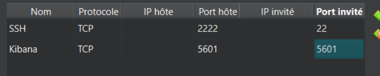
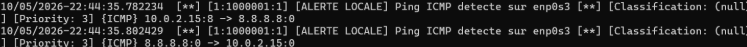
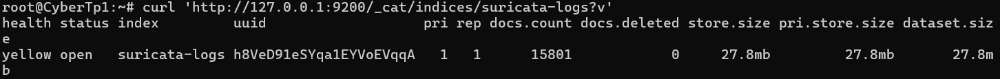

# Projet de cybersécurité : détection d'anomalies et gestion de logs

## 1. Présentation du projet

Le but de ce projet est de mettre en place un petit système de détection d'intrusions et de gestion de logs. Il permet de surveiller le trafic réseau, de détecter certains comportements définis dans des règles, puis de retrouver les alertes dans Kibana.

Le projet est réalisé dans une machine virtuelle sous **Ubuntu 26.04.1**. Snort n'ayant pas pu être installé avec les dépôts utilisés, nous avons choisi Suricata, qui est accepté dans le sujet.

L'objectif n'est pas de démontrer une compromission réelle à chaque test, mais de simuler cinq comportements suspects et de montrer qu'ils sont détectés, enregistrés et consultables.

## 2. Architecture utilisée

La chaîne de collecte est la suivante :

```text
Trafic réseau de test
        |
        v
Interface réseau de la VM : enp0s3
        |
        v
Suricata analyse le trafic et déclenche ses règles
        |
        v
/var/log/suricata/eve.json
        |
        v
syslog-ng lit le fichier EVE JSON
        |
        v
Elasticsearch : index suricata-logs
        |
        v
Kibana : Discover et visualisations
```

Les composants utilisés sont :

| Composant | Rôle dans le projet |
| --- | --- |
| Ubuntu 26.04.1 | Système de la machine virtuelle |
| Suricata | Analyse le trafic réseau et génère les alertes |
| syslog-ng | Lit le fichier EVE JSON de Suricata et envoie les messages à Elasticsearch |
| Elasticsearch | Stocke les événements dans l'index `suricata-logs` |
| Kibana | Permet de rechercher les événements et de les présenter dans un tableau ou un dashboard |

Dans cette configuration, syslog-ng lit directement le fichier `/var/log/suricata/eve.json`. Le fichier `fast.log` sert surtout à consulter rapidement les alertes dans le terminal, tandis que `eve.json` est la source envoyée à Elasticsearch.


## 3. Préparation de la machine virtuelle

### 3.1. Réseau VirtualBox et connexion SSH

La VM utilise l'interface réseau `enp0s3`, qui apparaît dans cette configuration avec l'adresse `10.0.2.15`. C'est l'interface que Suricata surveille.

Pour pouvoir utiliser le presse-papiers et le terminal de Windows, le serveur SSH est installé dans la VM :

```bash
sudo apt update
sudo apt install -y openssh-server
sudo systemctl enable ssh
sudo systemctl status ssh 
```

Dans la configuration réseau de VirtualBox, une redirection de port NAT est créée pour SSH : port hôte `2222` vers port invité `22`. Une autre redirection est utilisée pour Kibana : port hôte `5601` vers port invité `5601`.

Depuis PowerShell sous Windows, la connexion s'effectue avec le nom du compte Linux créé dans la VM :

```powershell
ssh -p 2222 <utilisateur_linux>@localhost
```



### 3.2. Installer Suricata

Snort n'a pas pu être installé avec les dépôts disponibles pendant le projet. Nous avons donc installé Suricata :

```bash
sudo apt update
sudo apt install -y suricata
sudo suricata-update
sudo systemctl enable suricata
sudo systemctl status suricata
```

Pour vérifier quelle interface est présente sur la VM :

```bash
ip a
```

Dans `/etc/suricata/suricata.yaml`, la configuration d'écoute a été adaptée à l'interface `enp0s3` plutôt qu'à `eth0`. Dans la section `rule-files`, le fichier local suivant est ajouté afin que Suricata charge les règles du projet :

```yaml
- /etc/suricata/rules/local.rules
```

Le fichier de règles est créé ou modifié avec :

```bash
sudo nano /etc/suricata/rules/local.rules
```

Pour vérifier que Suricata peut lire la configuration :

```bash
sudo suricata -T -c /etc/suricata/suricata.yaml
```

Si le test est valide, redémarrer le service :

```bash
sudo systemctl restart suricata
sudo systemctl status suricata
```

Les deux fichiers utiles pour les vérifications sont :

```bash
sudo tail -f /var/log/suricata/fast.log
```

```bash
sudo tail -f /var/log/suricata/eve.json
```

`fast.log` est plus lisible dans le terminal. `eve.json` contient les événements en JSON et c'est celui qui est lu par syslog-ng.

Un exemple d'alerte sur les pings, depuis `fast.log` :


## 4. Les cinq scénarios de détection

Les règles suivantes sont placées dans `/etc/suricata/rules/local.rules`. Chaque règle possède un identifiant (`sid`), un message, une classification et une priorité. La priorité est indiquée explicitement pour faciliter le tri dans Kibana.

Avant d'utiliser une classification, on peut vérifier qu'elle existe dans le fichier `/etc/suricata/classification.config` :

```bash
 grep -E 'classification: (web-application-activity|bad-unknown|network-scan|attempted-dos)' /etc/suricata/classification.config
```

### Scénario 1 — Paramètre HTTP suspect

Ce cas simule une attaque ciblée contre une application web. L'idée est qu'un attaquant modifie l'URL d'une requête pour essayer de déclencher un comportement inattendu dans l'application. Les applications web sont souvent exposées et peuvent constituer une porte d'entrée. Dans ce scénario, nous ne regardons donc pas seulement les adresses IP : nous inspectons aussi le contenu de la requête HTTP.

La règle recherche la chaîne `exploit=1` dans l'URL. Le mot-clé `content` indique la chaîne à rechercher, tandis que `http_uri` limite cette recherche à l'URI HTTP. La règle génère une alerte quand cette chaîne est détectée ; elle ne prouve pas qu'une vulnérabilité a réellement été exploitée.

Règle :

```text
alert http any any -> any any (msg:"[SCENARIO 1] Tentative Web - Parametre exploit detecte"; content:"exploit=1"; http_uri; classtype:web-application-activity; priority:2; sid:1000002; rev:1;)
```

Test :

```bash
curl "http://example.com/?exploit=1"
```

La priorité 2 signifie que l'événement doit être examiné, car il contient un indicateur potentiellement lié à une exploitation web.


### Scénario 2 — Tentative de connexion FTP non chiffrée

Ce scénario simule une tentative de connexion à un service FTP, qui utilise traditionnellement un protocole non chiffré. Les identifiants et les données transmis par FTP peuvent donc être exposés à une personne qui écoute le trafic. Nous surveillons ici le port TCP 21 et cherchons à signaler la tentative dès le début de la connexion, avant qu'un échange de données ait nécessairement lieu.

Dans la règle, `-> any 21` correspond à un trafic TCP à destination du port 21. Le paramètre `flags:S` vise les paquets SYN, utilisés pour initier une connexion TCP. La règle ne prouve pas qu'un mot de passe ou des données ont été transmis : elle signale un risque potentiel lié à l'utilisation de ce protocole.

Règle :

```text
alert tcp any any -> any 21 (msg:"[SCENARIO 2] Securite - Tentative de connexion FTP (Non chiffre)"; flags:S; classtype:bad-unknown; priority:2; sid:1000003; rev:1;)
```

Test :

```bash
timeout 5s curl telnet://example.com:21
```

La priorité 2 est retenue parce qu'une connexion à un service potentiellement non chiffré mérite une vérification. La classification `bad-unknown` reste prudente, car le paquet seul ne permet pas de confirmer une fuite de données.


### Scénario 3 — Trafic suspect vers le port 4444

Ce scénario surveille le trafic sortant de la VM et cherche une tentative de connexion TCP vers le port 4444, un port souvent associé à des outils de contrôle à distance et à certains outils de test d'intrusion. Nous partons de l'hypothèse qu'une machine aurait déjà été compromise et tenterait de joindre un serveur de commande. Cela permet d'illustrer que la surveillance ne concerne pas seulement les connexions entrantes, mais aussi les communications initiées depuis une machine potentiellement compromise.

Dans la règle, `-> any 4444` cible le port de destination 4444 et `flags:S` sert à repérer le paquet SYN au début de la connexion. Le port utilisé ne suffit toutefois pas à prouver qu'un cheval de Troie est présent : il s'agit d'un indicateur de trafic suspect à examiner.

Règle :

```text
alert tcp any any -> any 4444 (msg:"[SCENARIO 3] Compromission - Trafic suspect vers port backdoor Metasploit (4444)"; flags:S; classtype:bad-unknown; priority:2; sid:1000004; rev:1;)
```

Test :

```bash
timeout 5s curl telnet://example.com:4444
```

La priorité 2 est utilisée car cette tentative doit être vérifiée, tout en gardant une classification prudente : la règle se base essentiellement sur le port de destination.


### Scénario 4 — Indice de reconnaissance Nmap

Ce cas représente une phase de reconnaissance, c'est-à-dire le repérage effectué avant une attaque. Certains outils automatisés peuvent laisser leur nom dans l'en-tête HTTP `User-Agent`. La règle cherche ici la chaîne `Nmap` dans cet en-tête. Le mot-clé `content` définit le texte à rechercher et `http_header` indique que la recherche porte sur les en-têtes HTTP.

Cette simulation permet de montrer une détection basée sur le contenu du trafic, et pas seulement sur les adresses IP ou les ports. Elle ne correspond toutefois pas à un véritable scan de ports : un User-Agent contenant `Nmap` est un indice, pas une preuve qu'un scan a été réalisé.

Règle :

```text
alert http any any -> any any (msg:"[SCENARIO 4] Reconnaissance - Scanner Nmap detecte"; content:"Nmap"; http_header; classtype:network-scan; priority:3; sid:1000005; rev:1;)
```

Test :

```bash
curl -A "Nmap/7.92" "http://example.com"
```

La priorité 3 est retenue, car il s'agit d'un indice de reconnaissance : ce comportement peut être suspect, mais ne prouve pas à lui seul qu'une attaque est en cours.


### Scénario 5 — Paquet ICMP de grande taille

Ce scénario simule un paquet ICMP de grande taille, dans le but d'illustrer un indicateur possible de déni de service. Contrairement aux règles précédentes, nous ne cherchons pas ici une chaîne de caractères ou un port précis : nous examinons la taille des données contenues dans le paquet. Le mot-clé `dsize:>1000` déclenche une alerte lorsque cette taille dépasse 1000 octets.

Un paquet volumineux peut être anormal dans le contexte choisi, mais un seul paquet ne prouve pas un déni de service. Pour détecter un DoS réel, il faudrait notamment tenir compte du volume, de la fréquence et de la durée du trafic.

Règle :

```text
alert icmp any any -> any any (msg:"[SCENARIO 5] Attaque DoS - Paquet Ping geant detecte"; dsize:>1000; classtype:attempted-dos; priority:3; sid:1000006; rev:1;)
```

Test :

```bash
ping -s 1500 -c 1 8.8.8.8
```

La priorité 3 est retenue parce que la règle porte sur un paquet isolé et non sur un volume de trafic suffisant pour démontrer un déni de service.


### Recharger les règles après modification

Après avoir modifié `local.rules`, tester puis redémarrer Suricata :

```bash
sudo suricata -T -c /etc/suricata/suricata.yaml
sudo systemctl restart suricata
```

Chaque simulation peut parfois générer plusieurs alertes, par exemple si plusieurs paquets correspondent à la règle ou si une connexion retransmet des paquets. Il faudrait donc examiner les événements et pas seulement compter le nombre d'alertes.

## 5. Configurer syslog-ng pour envoyer les événements à Elasticsearch

Installer et activer syslog-ng :

```bash
sudo apt install -y syslog-ng
sudo systemctl enable syslog-ng
```

Créer le fichier de configuration :

```bash
sudo nano /etc/syslog-ng/conf.d/suricata-elk.conf
```

Configuration utilisée :

```conf
source s_suricata {
    file("/var/log/suricata/eve.json" flags(no-parse));
};

destination d_elasticsearch {
    elasticsearch-http(
        index("suricata-logs")
        url("http://127.0.0.1:9200/_bulk")
        template("${MESSAGE}\n")
    );
};

log {
    source(s_suricata);
    destination(d_elasticsearch);
};
```

La source indique à syslog-ng de lire le fichier `eve.json`. Le paramètre `flags(no-parse)` est utilisé parce que le fichier contient déjà des lignes JSON. La destination envoie les événements à Elasticsearch en utilisant l'index `suricata-logs`.

Vérifier la configuration et redémarrer le service :

```bash
sudo syslog-ng -s
sudo systemctl restart syslog-ng
sudo systemctl status syslog-ng
```

La commande `syslog-ng -s` ne renvoie normalement aucun texte si la vérification de syntaxe passe.

### Correctif rencontré avec syslog-ng 4.8.1

Dans notre VM, syslog-ng est en version `4.8.1`. La destination `elasticsearch-http()` ne transmettait pas correctement les événements à Elasticsearch. Le contournement appliqué a consisté à modifier le fichier SCL suivant :

```bash
sudo nano /usr/share/syslog-ng/include/scl/elasticsearch/elastic-http.conf
```

Dans ce fichier, la partie on supprime la partie : `index._type =’type’` et `type(“”)`.

Pour savoir si notre connexsion se fait, on peut mettre cette commande, et si on obtient une ligne à propose de suricata-logs comme l'index défini, alors notre système fonctionne.

```bash
curl 'http://127.0.0.1:9200/_cat/indices/suricata-logs?v'
```



## 6. Installer et configurer Elasticsearch et Kibana

### 6.1. Ajouter le dépôt Elastic et installer les paquets

Ajouter la clé et le dépôt Elastic 8.x :

```bash
wget -qO - https://artifacts.elastic.co/GPG-KEY-elasticsearch | sudo gpg --dearmor -o /usr/share/keyrings/elasticsearch-keyring.gpg

echo "deb [signed-by=/usr/share/keyrings/elasticsearch-keyring.gpg] https://artifacts.elastic.co/packages/8.x/apt stable main" | sudo tee /etc/apt/sources.list.d/elastic-8.x.list

sudo apt update
sudo apt install -y elasticsearch kibana
```

### 6.2. Configuration d'Elasticsearch

Modifier le fichier :

```bash
sudo nano /etc/elasticsearch/elasticsearch.yml
```

Pour cette VM de laboratoire, la sécurité Elastic a été désactivée avec :

```yaml
xpack.security.enabled: false
```

Cette configuration simplifie les essais locaux.

### 6.3. Configuration de Kibana

Modifier le fichier :

```bash
sudo nano /etc/kibana/kibana.yml
```

Pour accéder à Kibana depuis Windows via la redirection de port VirtualBox, la configuration utilisée contient :

```yaml
server.host: "0.0.0.0"
```

Le réglage `server.host: "0.0.0.0"` permet à Kibana d'écouter sur les interfaces de la VM.

Activer puis démarrer les services :

```bash
sudo systemctl enable elasticsearch kibana
sudo systemctl restart elasticsearch kibana
sudo systemctl status elasticsearch
sudo systemctl status kibana
```

Depuis Windows, ouvrir :

```text
http://localhost:5601/
```


## 7. Vérifier que les événements arrivent automatiquement dans Elasticsearch

Vérifier qu'Elasticsearch répond :

```bash
curl http://127.0.0.1:9200
```

Vérifier que l'index existe :

```bash
curl 'http://127.0.0.1:9200/_cat/indices/suricata-logs?v'
```

Compter les documents enregistrés :

```bash
curl -s 'http://127.0.0.1:9200/suricata-logs/_count?pretty'
```

Pour rechercher les alertes et afficher les plus récentes :

```bash
curl -s -X POST 'http://127.0.0.1:9200/suricata-logs/_search?pretty' \
  -H 'Content-Type: application/json' \
  -d '{
    "size": 10,
    "query": {
      "match": {
        "event_type": "alert"
      }
    },
    "sort": [{"timestamp": {"order": "desc"}}],
    "_source": [
      "timestamp",
      "event_type",
      "src_ip",
      "dest_ip",
      "alert"
    ]
  }'
```

Le résultat doit contenir des documents avec `event_type` égal à `alert`, la signature de la règle, les adresses IP et le timestamp. Pour vérifier l'automatisation, relever le nombre de documents, relancer une simulation puis refaire la commande. Le nombre doit augmenter sans qu'un document soit inséré manuellement.


## 8. Visualiser les alertes dans Kibana

### 8.1. Créer une Data View

Dans Kibana :

On ouvre **Stack Management**, puis **Data Views**.
On crée une Data View dont le nom ou le motif est `suricata-logs`.


### 8.2. Chercher les alertes dans Discover

On ouvre **Discover**, sélectionner la Data View `suricata-logs`, on définit une période qui comprend les tests réalisés. Et dans la barre de recherche, on peut mettre :

```text
event_type : "alert"
```

Les champs utilisés sont :

- `alert.severity` : priorité de l'alerte ;
- `alert.signature` : nom et message de la règle déclenchée ;
- `dest_ip` : adresse IP de destination ;
- `src_ip` : adresse IP source ;
- `timestamp` : date et heure de l'événement ;


## 10. Limites et conclusion

Le projet permet de détecter certains comportements définis dans des règles, de conserver les événements dans Elasticsearch et de les visualiser dans Kibana. Il montre également comment relier les outils dans une chaîne de collecte de logs.

Cela reste une introduction. Les tests reposent sur des motifs connus et faciles à reproduire. Une alerte ne prouve pas toujours qu'une attaque réelle a réussi : par exemple, un User-Agent contenant `Nmap` est un indice de reconnaissance, et un seul paquet ICMP volumineux ne suffit pas à confirmer un déni de service.

Le système peut donc produire des faux positifs ou des faux négatifs. Nous pourrions affiner les règles et les tester avec davantage de scénarios. Dans cette configuration, Suricata est utilisé comme IDS : le trafic est détecté et journalisé, mais il n'est pas automatiquement bloqué. Une suite possible serait d'ajouter une réponse aux alertes, des seuils pour réduire les événements répétitifs et une notification automatique à l'administrateur.

